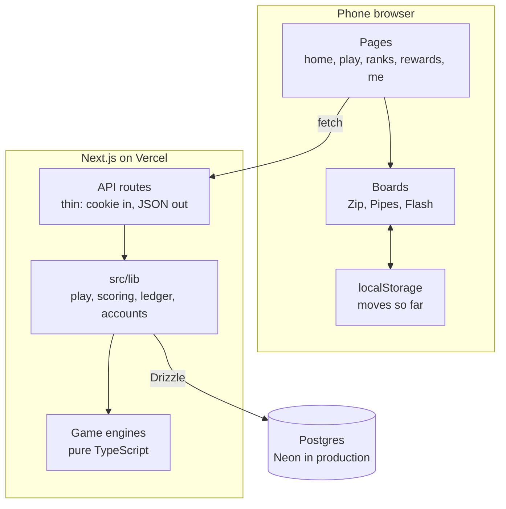
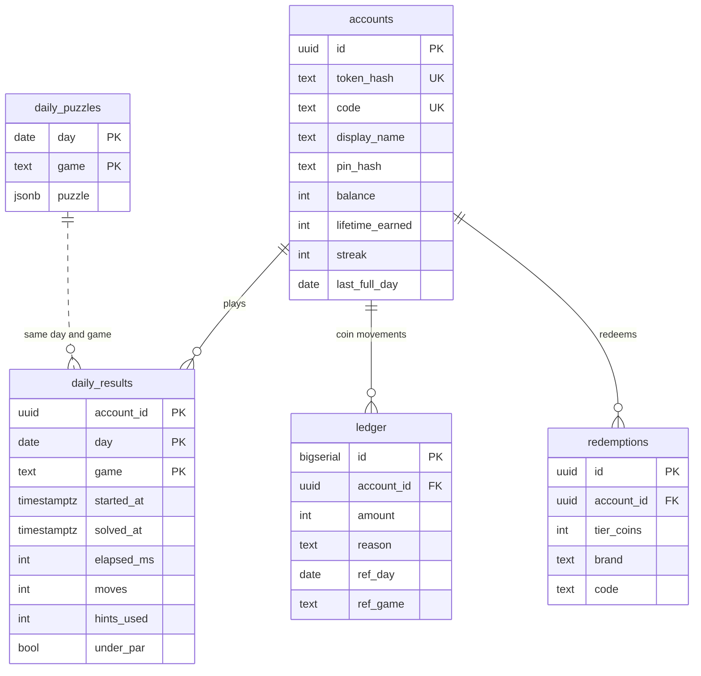
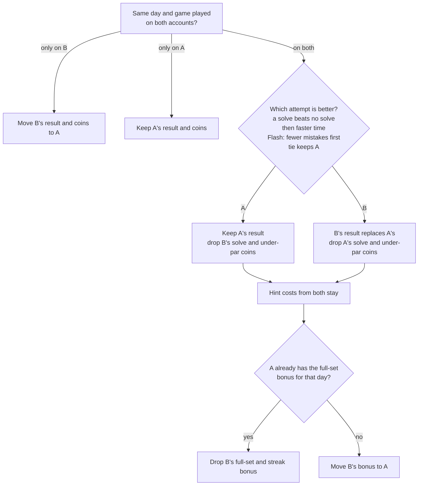
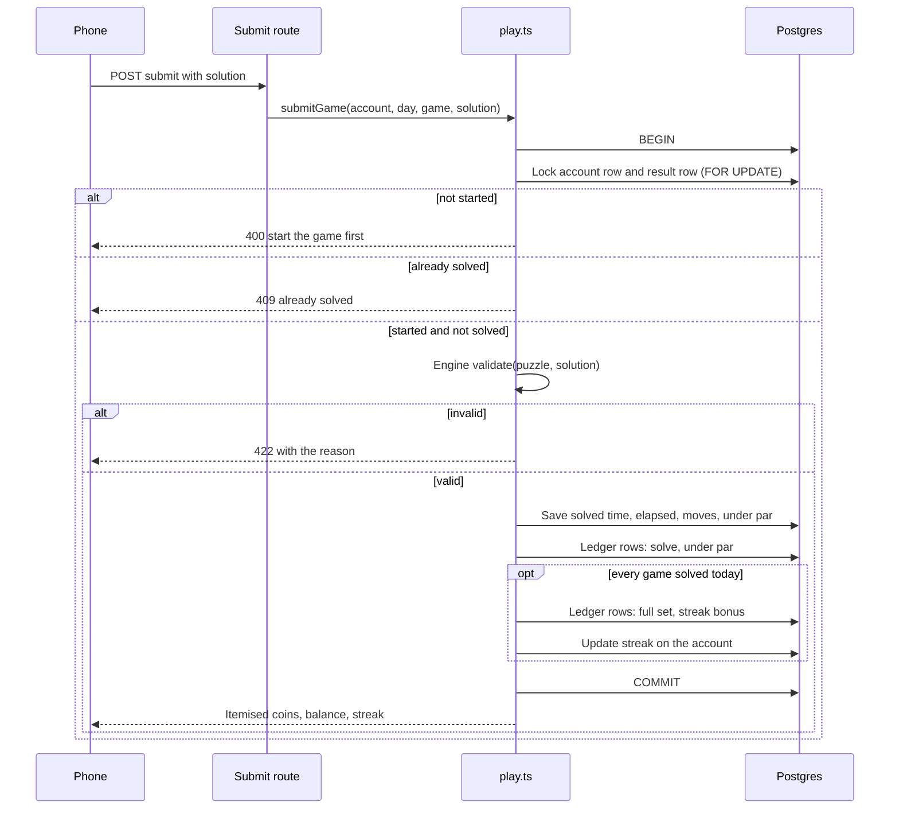
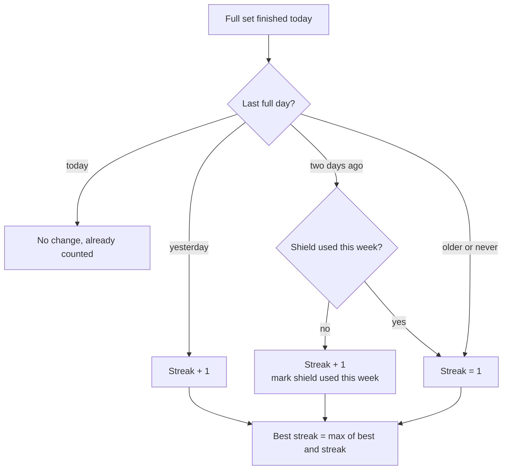
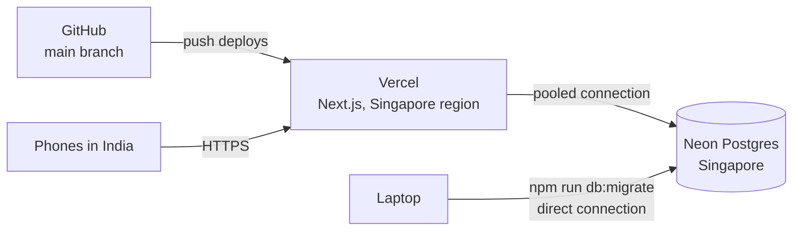

# Roz — Architecture

## 1. Stack and why

| Piece | Choice | Why |
|---|---|---|
| Framework | Next.js 16, App Router, TypeScript | One repo for pages and API routes; server-side generation and scoring live beside the UI. Note: Next 16 changed conventions; read `node_modules/next/dist/docs/` before writing code and disable `cacheComponents` so pages render dynamically per cookie. |
| Styling | Tailwind v4 | Fast to build responsive pages; purged CSS is 10 to 15 KB. No component library on top. |
| Fonts | `next/font/google` for Bricolage Grotesque and Public Sans | Self-hosted, subset, no layout shift. |
| Database | Postgres: Neon free tier in production, Docker locally | Relational data (accounts, results, ledger) with real constraints. |
| ORM | Drizzle with the `postgres` (postgres-js) driver | Typed queries, one schema file, one migration command. Works against both local Postgres and Neon's pooled connection string. |
| Hosting | Vercel free tier | Free, HTTPS, does not sleep, deploys from GitHub. |
| Tests | Vitest | Engines and scoring are pure functions; tests run in seconds. |



Not used: auth library (cookie plus PIN is about 40 lines), Redis or cron (puzzles are seeded by date), state library (each board is one component), canvas (grids are divs and SVG), analytics, service worker.

## 2. Repository layout

```
roz/
  README.md                 clone → run
  EXPLAINER.md              what, why, what was left out, where AI helped
  docker-compose.yml        local Postgres on 5433
  .env.example              DATABASE_URL, DAILY_SEED_SECRET
  drizzle.config.ts
  drizzle/                  generated SQL migrations
  src/
    app/
      layout.tsx            fonts, metadata, viewport
      globals.css           Tailwind import + theme tokens
      page.tsx              Home
      play/[game]/page.tsx  Zip | Pipes | Flash (daily or ?practice=1)
      solved/[game]/page.tsx
      ranks/page.tsx
      rewards/page.tsx
      me/page.tsx
      me/pin/page.tsx
      restore/page.tsx
      api/
        me/route.ts                       GET account summary
        daily/route.ts                    GET today's three puzzles + my state
        games/[game]/start/route.ts       POST stamp start time
        games/[game]/hint/route.ts        POST hint for current state (charges coins)
        games/[game]/submit/route.ts      POST solution → validate, score, ledger
        ranks/route.ts                    GET weekly / all-time
        rewards/redeem/route.ts           POST tier + brand → coupon
        account/name/route.ts             POST display name
        account/pin/route.ts              POST set or change PIN
        account/restore/route.ts          POST code + PIN → swap cookie, merge
    lib/
      games/
        rng.ts              seeded PRNG (mulberry32) + string hash, isomorphic
        zip.ts              generate / validate / hint / solver
        pipes.ts            generate / validate / hint / flow
        flash.ts        generate / validate / hint / min-solution
        index.ts            registry: { zip, pipes, flash } with par and labels
      db/
        schema.ts           Drizzle tables
        client.ts           postgres-js connection (max 1 in serverless)
      session.ts            read/create cookie account
      accounts.ts           create, code generation, PIN hash (scrypt), restore + merge
      daily.ts              puzzle date (IST), get-or-create daily puzzles
      scoring.ts            coin rules, par, streak, level thresholds (pure)
      ledger.ts             credit/debit with reason, atomic with balance
      leaderboard.ts        weekly + all-time queries
      rewards.ts            tiers, redeem, code generation
    components/
      Header.tsx, PlayBar.tsx, GameCard.tsx, CoinPill.tsx
      boards/ZipBoard.tsx, PipesBoard.tsx, FlashBoard.tsx
      HintButton.tsx, ShareButton.tsx, NamePrompt.tsx
  tests/
    zip.test.ts, pipes.test.ts, flash.test.ts, scoring.test.ts
```

Rule: everything in `src/lib/` is framework-free TypeScript. API routes are thin: read cookie, call a lib function, return JSON. This keeps logic testable and means the backend could be lifted into a standalone service later without rewriting it.

## 3. Data model



Full column list:

```sql
accounts
  id              uuid pk
  token_hash      text unique          -- sha256 of the cookie token
  code            text unique          -- WORD-1234
  display_name    text                 -- default 'Player ####'
  pin_hash        text null            -- scrypt; null = unprotected
  pin_failed      int default 0
  pin_locked_until timestamptz null
  balance         int default 0        -- derived cache of ledger sum
  lifetime_earned int default 0
  streak          int default 0
  best_streak     int default 0
  last_full_day   date null
  shield_week     text null            -- ISO week in which the shield was used, e.g. '2026-W42'
  created_at      timestamptz

daily_puzzles
  day             date
  game            text                 -- 'zip' | 'pipes' | 'flash'
  puzzle          jsonb                -- full puzzle incl. solution (never sent to client)
  primary key (day, game)

daily_results
  account_id      uuid fk
  day             date
  game            text
  started_at      timestamptz
  solved_at       timestamptz null
  elapsed_ms      int null
  moves           int null             -- Flash: mistakes
  hints_used      int default 0
  under_par       bool default false
  primary key (account_id, day, game)

ledger
  id              bigserial pk
  account_id      uuid fk
  amount          int                  -- signed
  reason          text                 -- 'solve' | 'under_par' | 'full_set' | 'streak' | 'hint' | 'redeem' | 'weekly_top3'
  ref_day         date null
  ref_game        text null
  created_at      timestamptz

redemptions
  id              uuid pk
  account_id      uuid fk
  tier_coins      int
  rupees          int
  brand           text                 -- 'amazon' | 'flipkart' | 'zomato'
  code            text                 -- DEMO-XXXX-XXXX
  created_at      timestamptz
```

Indexes: `daily_results(day, game)`, `ledger(account_id, created_at desc)`, `daily_results(account_id, day)`.

`balance` is a cache; every write goes through `ledger.ts`, which inserts the row and updates `balance` and `lifetime_earned` in one transaction. A debit that would go negative is rejected.

## 4. Identity and sessions

- Cookie `dt_session`: 32 random bytes, hex, `httpOnly`, `secure` in production, `sameSite=lax`, one-year expiry. The DB stores only its SHA-256 hash.
- Middleware is not used; each API route and page calls `getOrCreateAccount()` which reads the cookie, looks up the hash, and creates an account if missing. Pages that create an account set the cookie in a route handler or server action, since cookies cannot be set during render.
- Account code: a word from a list of about 200 simple nouns (fruits, animals, colours) plus four digits, checked unique on insert.
- PIN: 4 digits, hashed with Node's `scrypt` and a per-account salt. Compare with `timingSafeEqual`.
- Restore: `POST /api/account/restore {code, pin}`.
  1. Look up account A by code. If `pin_locked_until` is in the future, 423.
  2. Verify PIN; on failure increment `pin_failed`, lock for one hour at five, 401.
  3. Load the current cookie's account B (if any, and if B ≠ A).
  4. Transaction: for every day and game, keep the better of the two attempts and move B's other rows to A (rules below); delete B.
  5. Rotate A's token, set the cookie, return A's summary.
- Merge rules live in `src/lib/merge.ts` as a pure function with tests. A puzzle never pays twice:



Rows that are not tied to a puzzle (redemptions, other days) always move. A's balance and lifetime total change by exactly the coin rows that were moved or dropped. The balance can go below zero if B had spent coins it no longer has; debits then fail until it is earned back.

## 5. Daily puzzles

- Puzzle day = `Intl.DateTimeFormat('en-CA', {timeZone: 'Asia/Kolkata'})` date of now.
- Seed = `hash(DAILY_SEED_SECRET + day + game)`. The secret stops anyone computing tomorrow's puzzle from the client bundle.
- `getDailyPuzzle(day, game)`: select from `daily_puzzles`; if missing, generate with the seed, `insert ... on conflict do nothing`, re-select. Every server instance agrees even if two generate at once.
- The client receives the puzzle **without** its solution: Zip gets numbers and walls; Pipes gets tile shapes and initial rotations; Flash gets the sequence (it must be shown, so it is not secret; the server still replays attempts).
- Generation cost: Zip uniqueness search is capped (max 12 walls, solver node cap 200k) so a cold generation stays under about 200 ms. Pipes and Flash are sub-millisecond.

## 6. Game protocol

```
POST /api/games/:game/start           → { startedAt }      (idempotent; first call stamps)
POST /api/games/:game/hint   {state}  → { hint, hintsUsed, charged, balance }
POST /api/games/:game/submit {solution} → { ok, elapsedMs, moves, coins: [{reason, amount}], total, setDone, streak }
```

The submit call, end to end:



Solution shapes:
- zip: `{ path: number[] }` cell indices in order.
- pipes: `{ rotations: number[] }` clockwise quarter-turns applied per cell, relative to the served initial state.
- flash: `{ attempts: number[][] }` every attempt in order; the server replays them.

Submit rules (server):
1. Must have a `daily_results` row with `started_at` and no `solved_at`.
2. Engine `validate(puzzle, solution)` must pass.
3. `elapsed_ms = now − started_at`. Under par = elapsed ≤ par (Zip, Pipes) or count ≤ par (Flash: mistakes), **and** `hints_used = 0`.
4. Credit: solve +10; under par +5.
5. If this completes the day's three: full set +15; update streak (see 7); streak bonus = min(2 × streak, 20).
6. All inside one transaction, with `select ... for update` on the account row.

Hint rules:
- Free while `hints_used < 2`; else debit 5, reject with 402 if balance < 5.
- Any hint clears eligibility for the under-par bonus for that game.
- Hint payloads: zip `{ next: cellIndex }` or `{ keep: n }`; pipes `{ cell, rotation }`; flash `{ cell }`.

Timer: `started_at` is set once by `/start` (called when the board mounts). Elapsed is computed on the server at submit. The client shows a running clock from `startedAt` for display only.

## 7. Streak computation (pure function in `scoring.ts`)




```
input: lastFullDay, streak, shieldWeek, today, isoWeek(today)
if lastFullDay == today            → unchanged (already counted)
if lastFullDay == today − 1        → streak + 1
if lastFullDay == today − 2 and shieldWeek ≠ isoWeek(today)
                                   → streak + 1, shieldWeek = isoWeek(today)
else                               → 1
bestStreak = max(bestStreak, streak)
```

## 8. Leaderboard queries

Weekly (Monday 00:00 IST to Sunday): from `daily_results` where `solved_at` is not null and `day` in week, group by account, count days with 3 solves as `sets`, sum `elapsed_ms` over those days as `time`. Order by `sets desc, time asc`. Limit 50, plus the caller's own row and rank via a window function.

All time: `accounts` order by `lifetime_earned desc`.

## 9. Client state

- `localStorage['dt:<day>:<game>']` holds the board state (path / rotations / presses). Written on every move, read on mount, deleted after submit. Keys from other days are purged on Home load.
- Practice mode uses the same board components with a locally generated puzzle and `onSubmit` that just shows the result, no network.
- Display timer: `Date.now() − startedAt` every 250 ms; only for show.

## 10. Security and fairness checklist

- Solutions never leave the server.
- All scoring server-side; client cannot post coins or times.
- Cookie token hashed at rest; PIN scrypt-hashed; restore rate-limited and locked.
- Submit is transactional and idempotent (second submit for a solved game returns 409).
- Hints are counted server-side so a reload cannot reset them.
- Input validation on every route (lengths, ranges, enums) before touching the DB.
- Debits cannot take a balance negative.

## 11. Local development and deployment

Local:
```
docker compose up -d          # Postgres on localhost:5433
cp .env.example .env.local    # DATABASE_URL + DAILY_SEED_SECRET
npm install
npm run db:migrate            # drizzle-kit migrate
npm run dev                   # http://localhost:3000
npm test                      # vitest
```

Production:



1. Create a Neon project, copy the pooled connection string into Vercel as `DATABASE_URL`; set `DAILY_SEED_SECRET` to any long random string.
2. Import the GitHub repo in Vercel; build command is the default.
3. Run `npm run db:migrate` once against the Neon URL from the laptop (or add it to the Vercel build command).
4. Open the Vercel URL on a phone.

## 12. Known limits

- Zip uniqueness is best-effort under the caps; any valid path is accepted at submit, so a non-unique puzzle is still fair.
- Switching browsers before setting a PIN loses access to that browser's coins; the app nags once at first solve and once at 100 coins.
- Weekly top-3 bonus needs a scheduled job; if shipped, it runs as a Vercel cron hitting an internal route guarded by a secret.
