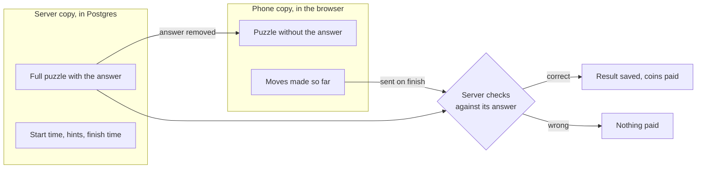
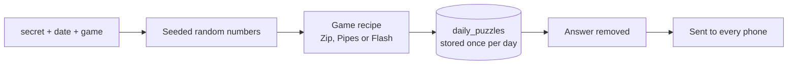
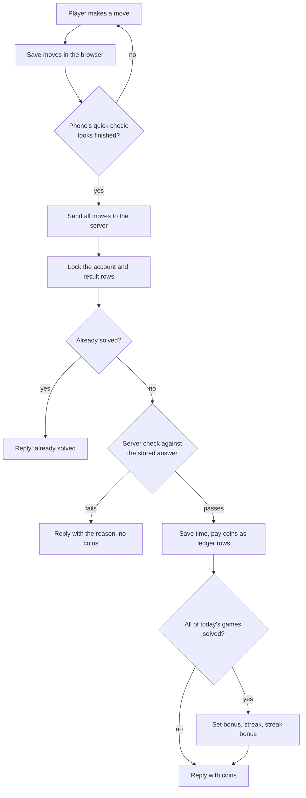

# How Roz works, in plain words

This is the story of one day in Roz: where the puzzles come from, how a board is drawn, what the browser keeps, what the server keeps, and how we know a puzzle is finished. No code, just the ideas. File names are given so you can open the real thing.

---

## 1. The big picture

Every day has the same puzzles for everybody. The server makes them, remembers them, and keeps the answers. The phone only gets what it needs to draw the board. When the player finishes, the phone sends the moves to the server, the server checks them against its own copy, and only then are coins given.

So there are always two copies of a game in play:



| Where | What it holds | Why |
|---|---|---|
| Server (Postgres) | The full puzzle **with** the answer, when the player started, how many hints they took, when they finished | Coins are real money, so the server decides everything that pays |
| Phone (browser) | The puzzle **without** the answer, and the moves made so far | So the board can be drawn and the player can leave and come back |

---

## 2. How a puzzle is created

### The seed

A puzzle is made by a random generator, but a special kind: a **seeded** one. Give it the same seed and it produces the same puzzle every time. The seed for a day is:

```
secret + date + game name      e.g.  "xyz|2026-10-13|zip"
```

The secret is an environment variable on the server. Because of it, nobody can work out tomorrow's puzzle from the app's code. Because of the date, everyone in the world gets the same puzzle today. Because of the game name, Zip and Pipes get different puzzles even on the same day.

Code: `src/lib/games/rng.ts` (the seeded random numbers) and `dailySeed()` in `src/lib/games/index.ts`.



### Making it once, keeping it

The first time anyone asks for today's puzzle, the server generates it and writes it into the `daily_puzzles` table, answer included. Everyone after that reads the stored copy. If two servers happen to generate at the same moment, the database keeps only one. Code: `src/lib/daily.ts`, `getDailyPuzzle()`.

### Each game's recipe

**Zip** (`src/lib/games/zip.ts`)
1. Walk a random path that visits every cell of the 6×6 grid exactly once. This walk is the answer.
2. Mark 6 cells along the walk as the numbers 1 to 6, the first and last cell fixed, the rest spread out.
3. Add walls on edges the walk does **not** cross, one at a time, until a solver finds only one way to complete the puzzle. Stop at 12 walls if it never becomes unique.
4. Send the phone: grid size, where the numbers are, where the walls are. Keep the walk.

**Pipes** (`src/lib/games/pipes.ts`)
1. Carve a random tree through the 5×5 grid by a depth-first walk, so every cell is connected to every other with no loops. Long corridors, few dead ends.
2. Pick one cell as the water tank. Every dead end becomes a house. Each cell's pipe shape is just "which sides are connected": straight, corner, T or cross.
3. Spin every tile a random number of quarter turns. If by luck it is still solved, spin one more.
4. Send the phone: tank position, which cells are houses, and the **spun** shapes. Keep the unspun shapes as the answer.

**Flash** (`src/lib/games/flash.ts`)
1. Pick a sequence of 5 tiles on a 3×3 grid, never the same tile twice in a row.
2. Round 1 shows the first 3, round 2 the first 4, round 3 all 5.
3. Send the phone the whole sequence. It has to, or the phone could not show it. This is the one game where the phone knows the answer, which is why the server still replays every attempt (section 6).

---

## 3. How the board is drawn

Boards are plain HTML, not canvas, so they stay crisp on cheap phones and cost nothing to render. Each board is a "dumb" component: it draws what it is given and reports taps. It never talks to the server. Code: `src/components/boards/`.

**Zip board.** One square box. Underneath is an SVG with thin grid lines, thick wall segments, and the path drawn as one thick orange line through cell centres. On top is an invisible grid of cells holding the black number circles. Dragging works with pointer events: on touch-down we find the cell under the finger; as the finger moves we add the next cell if it is a neighbour, not a wall, not already used, and the next number in order. Sliding back over the previous cell removes it. The whole thing is a list of cell numbers, nothing more.

**Pipes board.** A grid of buttons. Each button draws its pipe from the shape it was given, and the whole drawing is rotated with CSS by the number of taps so far, which gives the little spin animation. The colour comes from a tiny "where does water reach" calculation that runs on every tap: start at the tank, flow into any neighbour whose pipe end faces back, repeat. Wet pipes are blue, dry grey, houses turn green when reached.

**Flash board.** Nine buttons. In the "showing" phase a timer lights them up one at a time from the sequence, then hands control to the player. In the "input" phase a tap turns green if it was the right next tile and red if not.

The screen around the board (status line, hint dots, buttons, how-to) is shared by all games: `src/components/play/PlayLayout.tsx`. Each game has one small file that plugs its board into that frame: `src/components/play/games/`.

---

## 4. What happens when a player opens a puzzle

1. **The page loads** from the server with today's puzzle (answer removed), the player's coins and streak, and, if they played earlier today, when they started and how many hints they used.
2. **The start is stamped.** The first time the board appears, the phone calls `POST /api/games/zip/start`. The server writes a row in `daily_results` with the current time. This row is the player's record for that game that day. Calling it again does nothing, so a reload cannot reset the clock.
3. **The clock runs**, but only for show. The number on screen is "now minus the server's start time". The real time is measured on the server at the end.
4. **Every move is saved in the browser** under a key like `roz:2026-10-13:zip`. If the player closes the tab or takes a call, reopening the page restores the board exactly. Saved boards from older days are thrown away when a new day starts.

What is **not** on the phone: the answer, the coins logic, the hint count that matters. If someone clears the browser they lose their half-drawn path, nothing else.

---

## 5. Hints

A hint is a request to the server: "here is my board so far, what next?" The server looks at its answer copy and replies with one small thing:

- Zip: the next correct cell, or "your path went wrong after box N" so the phone trims it.
- Pipes: one wrong tile and the rotation that fixes it. The phone turns it and locks it.
- Flash: the next tile to tap.

The server also counts the hint. The first two per game per day are free; after that it takes 5 coins first and refuses if the balance is too low. Any hint cancels the under-par bonus for that game. Because the count lives on the server, reloading the page does not give free hints back.

---

## 6. How we know it is done

The phone does a quick local check after every move, purely to know when to send. The server does the real check.

**On the phone** (so the player gets instant feedback):
- Zip: the path has 36 cells and passes every rule.
- Pipes: every house is wet.
- Flash: round 3 has been reproduced.

The moment this is true, the phone sends the whole solution to `POST /api/games/<game>/submit`:

- Zip sends the list of cells in order.
- Pipes sends how many quarter turns each tile got.
- Flash sends every attempt made, round by round, including the wrong ones.



**On the server**, inside one database transaction so nothing can be half-done:
1. Lock the player's account row and their result row for this game. If the result is already marked solved, answer "already solved" and stop. This is what makes a double tap or a replayed request harmless.
2. Run the game's validator against the stored puzzle:
   - Zip: start at 1, every step is to a neighbour, no wall crossed, numbers in order, every cell used, ends on the last number.
   - Pipes: apply the turns to the original shapes, run the water flow, confirm every house is wet.
   - Flash: replay the attempts in order. Each attempt that matches the round exactly moves to the next round; any other attempt counts one mistake. Solved only if round 3 was passed.
3. If it fails, reply with the reason and give nothing.
4. If it passes: time taken = now minus the stamped start. Under par means faster than the game's par (or fewer mistakes than par for Flash) **and** zero hints.
5. Write solved time, elapsed, mistakes and under-par into the result row.
6. Pay coins by writing rows into `ledger`: +10 for the solve, +5 if under par. Then count how many of today's games this player has solved. If it is all of them: +15 set bonus, update the streak, and pay the streak bonus. Every coin that ever moves is a ledger row, and the account balance is just the running total of those rows.
7. Reply with the itemised coins, the new balance, and whether the set is complete.

The phone then deletes its saved board for that game and shows the result screen using the server's numbers, not its own.

---

## 7. What "a day" means

The day boundary is midnight in India (Asia/Kolkata), computed on the server. A puzzle started at 11:58 pm and finished at 12:02 am still belongs to the earlier day, because the submit is matched to the result row that was started, not to the clock at submit time. Streaks count only days where every puzzle was solved, with one free "shield" per week that forgives a single missed day.

---

## 8. Practice mode

Practice uses the same boards and the same engines, but the puzzle is generated from a random seed on each visit and the answer is sent to the phone too, so hints and the "done" check happen locally with no server calls. No start is stamped, nothing is saved, no coins are paid.

---

## 9. Where to look

| Question | File |
|---|---|
| How is a puzzle generated / checked / hinted? | `src/lib/games/<game>.ts` |
| Which games exist? | `src/lib/games/index.ts` (the registry) |
| Today's puzzle, stored once | `src/lib/daily.ts` |
| Start, hint, submit, coins | `src/lib/play.ts` |
| Coin amounts, par, streak rules, levels | `src/lib/scoring.ts` |
| Every coin movement | `src/lib/ledger.ts` |
| The board drawings | `src/components/boards/` |
| The play screen glue (start, clock, hints, submit) | `src/components/play/useGameSession.ts` |
| One small component per game | `src/components/play/games/` |
| Tests that prove the engines | `tests/` |
